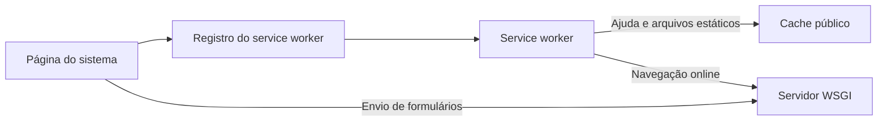

# Etapa 8 — Aplicativo instalável

## Navegação após entrar

Use o menu lateral para acessar as áreas do laboratório. **Reservas e chaves** reúne as páginas de agendamento e controle de chaves. Em telas estreitas, abra **Menu** para ver os atalhos.

No perfil do Chefe, **Gerenciar usuários** reúne os cadastros de alunos e professores. **Configurar laboratório** leva a Manutenção, Restrições e Limites de reserva. O círculo no perfil apresenta as iniciais do nome cadastrado.

## Instalar

1. Inicie o sistema pelo VS Code ou terminal, conforme o [guia principal](../README.md).
2. Abra o endereço informado pelo sistema em um perfil normal do Microsoft Edge ou Google Chrome. Use o mesmo endereço no restante da demonstração. Para o navegador, `localhost` e `127.0.0.1` são endereços distintos.
3. Escolha a opção de instalação na barra de endereços ou no menu do navegador e confirme. O Sistema de Gestão de Laboratório de Pesquisa abre em uma janela própria e passa a aparecer na lista de aplicativos do navegador.

## Demonstrar a consulta offline

1. Com o servidor em execução, abra o aplicativo e clique em **Ajuda**. No navegador, **Application → Service Workers** das ferramentas do desenvolvedor mostra quando o worker está ativo.
2. Pare temporariamente o servidor de demonstração e recarregue a ajuda. O texto e os estilos continuam disponíveis. Clique em **Abrir o sistema** para mostrar o aviso de indisponibilidade.
3. Reinicie o servidor e clique em **Tentar novamente**. A autenticação e as demais operações voltam a depender normalmente da conexão com o servidor.

Parar o servidor demonstra a perda de conexão com o sistema mesmo quando o navegador e o servidor estão no mesmo computador. Para demonstrar o fluxo online, use o banco de teste e usuários fictícios.

## Arquivos para explicar na apresentação

- `manifest.webmanifest` informa ao navegador o nome, os ícones, a página inicial e o modo de abertura.
- `registrar-pwa.js` registra o service worker no endereço local em contexto seguro.
- `service-worker.js` guarda apenas a ajuda pública, a página de indisponibilidade e os arquivos estáticos da lista. As páginas autenticadas e os PDFs são solicitados ao servidor. Formulários dependem da conexão e o aplicativo faz o envio no momento da interação.
- `web.py` atende os arquivos públicos e mantém a autenticação, a proteção CSRF e os cabeçalhos de segurança das operações.

O endereço do CSS inclui uma revisão calculada a partir de seu conteúdo. Após reiniciar o servidor com um CSS novo, o navegador online recebe essa versão mesmo que o service worker anterior ainda esteja ativo. Ao mudar a ajuda ou outro arquivo da lista offline, incremente a versão do cache no service worker. Feche as janelas do aplicativo e reabra-o online para atualizar os arquivos usados offline.

## Demonstrar o alerta de chaves

1. Com uma reserva confirmada e uma cópia compartilhada para o local, registre a chave como **Indisponível** ou **Extraviada**.
2. Se faltar uma cópia utilizável, confira **Notificações** nas contas do Chefe e de quem tem reserva afetada. A reserva continua confirmada. Uma cópia operacional, livre e compatível evita o aviso a quem ainda consegue retirar uma chave.
3. O mesmo aviso entra na fila de e-mail da Etapa 7. Para demonstrar o envio, configure um servidor SMTP de teste conforme o [guia da Etapa 7](README_Etapa7.md).
